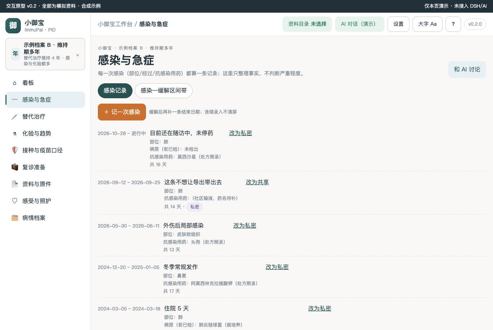
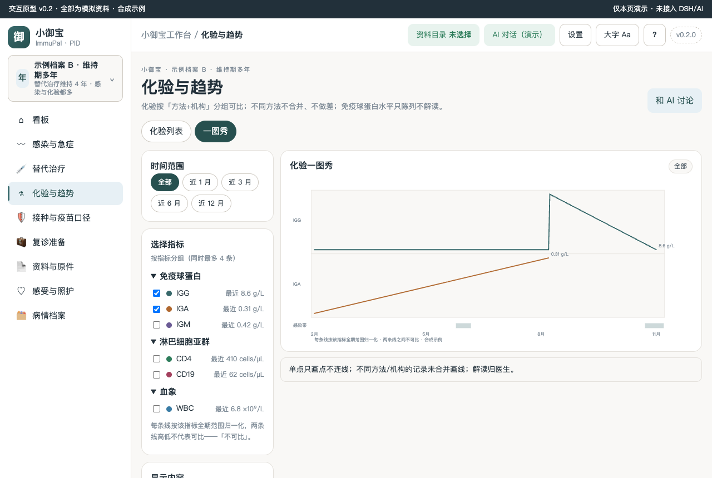
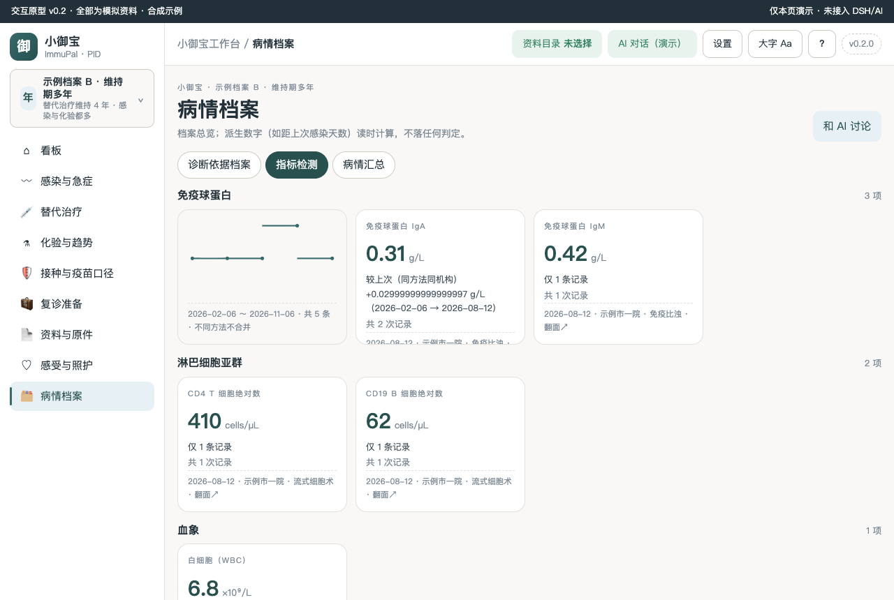
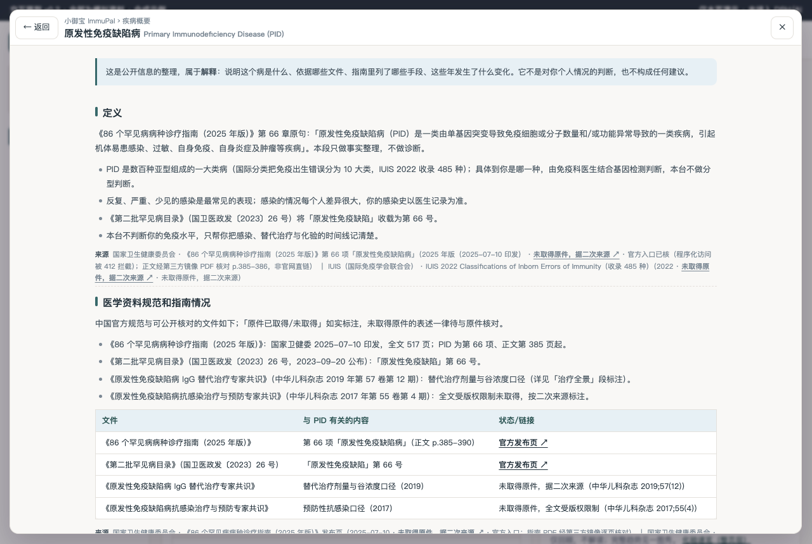
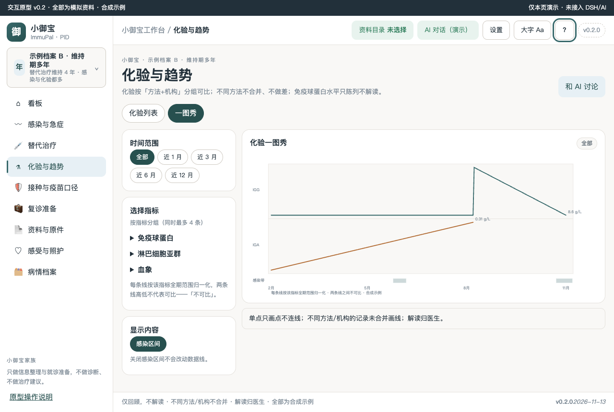

# 小御宝 ImmuPal · 原发性免疫缺陷病（PID）工作台

本机优先的 PID 患者工作台：感染事件档案、IVIG/SCIG 替代治疗按次记录、免疫球蛋白水平（可比组）展示、预防性用药与接种口径登记、复诊准备工作台。**只整理本机资料，不做诊断、不给处置建议、不做病情判定。**

> 状态：交互原型 v0.2.0（M2）· 全部数据为合成示例 · 未接入宿主 · 0 患者访谈 · 0 临床审核（阈值一律【待核】）

## 疾病概要

原发性免疫缺陷病（PID）是一大类遗传性免疫缺陷（《86 个罕见病病种诊疗指南（2025 年版）》第 66 项，正文 p.385；第二批罕见病目录第 66 号）：免疫细胞或分子数量/功能异常，最常见表现为反复、严重、少见的感染。工作台视角的病程结构：**确诊评估期 → 替代治疗启动期 → 维持期（感染监测）**，家长代记为主（R3 双视角）。

顶栏「？」或首页「疾病概要：原发性免疫缺陷病是什么？」可打开整页疾病概要（定义 → 医学资料规范和指南情况 → 治疗全景 → 发展趋势，每段强制来源行，四态标注原件/官方入口/二次来源/nolink）。

## 关键功能（截图墙）

**看板：状态卡 + 医生行动计划原话 + 最近报告**


状态卡数字（感染中第 N 天、距上次感染、距上次替代治疗、近 90 天/近 12 月感染次数）全部由你记录的事实算出，漏记会偏小，不代表医生判断。

**感染与急症：一条一条记，缓解后补结束日期**



**一图秀：化验按「方法+机构」可比组展示，不同方法不合并**



**指标卡：真 3D 翻转看走势，差值只在同方法同机构组内显示**



**疾病概要（整页四段，？按钮与首页文字按钮双入口）**



**折叠分组收/展态（一图秀 rail）**




## 怎么用

1. 独立预览：`cd prototypes/v0.2 && python3 -m http.server 8931`，浏览器打开 `http://127.0.0.1:8931/index.html`；
2. 侧栏可切换两套合成档案（A 刚确诊记录少 / B 维持期多年记录多），切换后整页联动不串档；
3. 每个可写页顶部有「＋ 添加」入口，表单 ≤6 字段、三态保存（保存并继续录入 / 保存并关闭 / 取消）；更正=新增版本，无裸删除；
4. 每页「和 AI 讨论」只填草稿不自动发送；私密记录不进看板摘要、导出与 AI 上下文（三出口同一过滤，页内可见「N 条中私密 M 条」）；
5. 装进 DSH Desktop 后（M6），资料目录必须选本机专用文件夹——主目录、桌面、下载根目录、tmp 一律拒绝。

## 数据与口径

- **仅回顾，不解读 · 不同方法/机构不合并 · 解读归医生**（与数字同屏）；
- 化验（IgG/IgA/IgM 谷浓度、淋巴细胞亚群）按「方法+机构」可比组展示；跨组不合并不做差不连线；
- 派生值（距上次感染天数、近 12 月感染次数、替代治疗参考间隔）读时计算，不落库、不判定；
- 接种口径只录医生已确认原话；本台不回答「能不能打疫苗」；
- 演示数据是唯一源（`prototypes/v0.2/demo-data.js`），页面不写死业务数字；全部标注合成示例；
- 医学原文引用与来源分级见 [docs/EVIDENCE-LEDGER.md](docs/EVIDENCE-LEDGER.md)（指南正文经第三方镜像 PDF 核对 p.385-390，非官网直链，如实标注）；
- 临床试验线裁剪：实测 ClinicalTrials.gov「primary immunodeficiency」601 条（短语检索，2026-11-12；`query.cond` 口径 733 条，2026-11-13）；裁剪理由与可推翻路径见 [docs/DEV-PLAN.md](docs/DEV-PLAN.md) §四。

## 开发

```bash
npm run check   # 静态检查链（17 项）
npm test        # 单测
node scripts/probe-disease-primer.mjs --url "http://127.0.0.1:<port>/prototypes/v0.2/index.html"
node scripts/probe-page-view.mjs --url "http://127.0.0.1:<port>/prototypes/v0.2/index.html"
node scripts/probe-primary-immunodeficiency-m2.mjs   # 自带静态服务，18 条叶子路由全量走查
```

- 版本：`VERSION` / package.json / 页脚 / ver-chip 四处同源（0.2.0-prototype 阶段随 M5 升版）；
- 移植声明：原型结构移植自 cidp-workbench v0.2.0（家族模板移植 + 病种语义重写），语义残留断言进 check 链；
- 截图由 `scripts/shoot-v0.2.0.mjs` 实渲生成，文件名含版本号；装机后以真机截图替换（Q30）。
